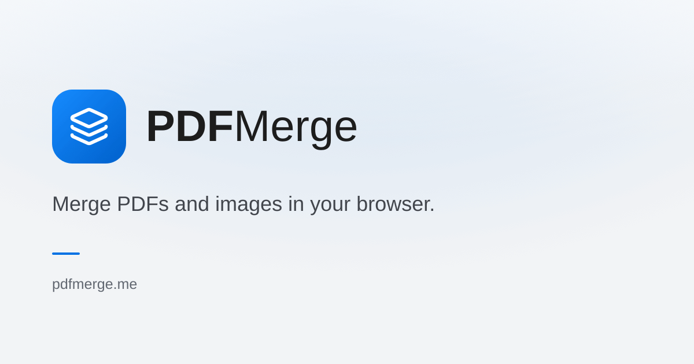

# PDFMerge

PDFMerge is a free, privacy-first web app for merging PDFs and images into a single document. All processing runs entirely in your browser: nothing is uploaded to any server.

Live at [pdfmerge.me](https://pdfmerge.me)

## Key Features

### File Handling

- **PDF and Image Merging**: Combine PDFs with JPG, PNG, WEBP, and GIF images
- **Drag and Drop**: Add files by dropping them anywhere on the page, or reorder cards by dragging. Keyboard users can choose files with **Choose files** and move a focused card with Alt+Arrow keys or Alt+Home/End
- **Sort Files**: Sort file cards once by natural filename order (A-Z or Z-A) or modification date (oldest or newest first). Blank pages stay in their slots
- **PDF Page Selection**: Specify page ranges (`1-5`), individual pages (`1,3,7`), or a mix (`1-3,5,8`) per PDF. Pages merge in the order typed, so `3,1,2` reorders and `1,1` repeats a page. Invalid tokens or page numbers block the merge and show an error under that card
- **Duplicate Files**: Add the same file more than once, for example to take different page ranges from one PDF
- **Blank Page Insertion**: Add blank separator pages to the output
- **Individual File Removal**: Delete specific files with per-card remove buttons

### Image Layout Options

Each image can be placed on its page in one of three modes:

- **Default Margins**: Scaled with printer-safe margins
- **Cover**: Cropped to fill the full page
- **Fit**: Scaled to fit with letterbox background

Use the Toggle Image Rotation button to rotate the image content 90, 180, or 270 degrees independently of the layout mode.

### Output Options

- **Paper Sizes**: A0, A1, A2, A3, A4, Letter, Legal, Tabloid
- **Page Orientation**: Toggle any image page between portrait and landscape
- **Image Numbers**: Optionally add sequential image numbers on images with Default Margins layout
- **Output Page Numbers**: Number every output page, including blank and duplex padding pages. Choose bottom centre, bottom right, or top right; a preset or custom template of up to 100 characters; and a starting number of 1 or greater. Templates use `{n}` for the current number, `{total}` for total output pages, `{file}` for the source name without its extension, and `{date}` or `{time}` for the local time captured when merging starts. Use `{n:3}` or `{total:3}` for zero padding (width 1–6), and `{{` or `}}` for literal braces. Blank-page cards have an empty file name; duplex padding uses the preceding card's name.
- **Header and Footer Text**: Add text on every output page, including blank and duplex padding pages. Each has a template of up to 100 characters and left, centre, or right alignment. Header defaults to centre; footer defaults to left. They use the same placeholders as page numbers, but plain text such as `CONFIDENTIAL` is valid. All three text options share the “Numbering starts at” value for `{n}`. If page numbers use the same edge and alignment as a header or footer, choose another alignment before merging.
- **Skip First Page**: Page numbers, header text, and footer text each have this option. The first output page still counts toward `{n}` and `{total}`; if skipped, page 2 uses the next number.
- **Text Colour**: Choose a separate colour for page numbers, header text, and footer text; each defaults to grey.
- **Text Style**: Page numbers, header text, footer text, and the text watermark each have bold, italic, and underline toggles. Text defaults to normal weight; the text watermark defaults to bold. Italic is a slanted Roboto, as no italic font file is bundled.
- **Text Background and Margin**: Each text option can add a solid background box with its own colour. Set its top or bottom and side margin from 0 to 50 mm in 0.5 mm steps; the default is 8.5 mm.
- **Duplex Padding**: Add a matching blank page after each card that produces an odd number of pages, except the final card
- **Image Details**: Optionally embed EXIF data (filename, date, GPS coordinates)
- **Image Hash**: Optionally embed SHA-256 hash per image for verification
- **Custom Filename**: User-defined output filename

Date and time default to `{date}` = `YYYY-MM-DD` and `{time}` = `HH:mm`. Either placeholder accepts the same tokens after its first colon, as in `{date:YYYY-MM-DD HH:mm}`. Wrap literal letters in brackets, for example `{date:[Day] D}`.

| Token | Output |
| --- | --- |
| `YYYY`, `YY` | Four-digit or two-digit year |
| `MMMM`, `MMM` | English month name, full or abbreviated |
| `MM`, `M` | Month, padded or unpadded |
| `DD`, `D` | Day of month, padded or unpadded |
| `dddd`, `ddd` | English weekday name, full or abbreviated |
| `HH`, `H` | 24-hour clock, padded or unpadded |
| `hh`, `h` | 12-hour clock, padded or unpadded |
| `mm`, `ss` | Padded minutes or seconds |
| `A` | `AM` or `PM` |

Examples: `Revised Page {n} of {total} - {date:D MMM YYYY}` and `{file} {date:YYYY-MM-DD} {time:hh:mm A}`.

### Watermarking

- Text watermark with colour, opacity, rotation, and scale
- Image watermark from a PNG (transparency kept) or JPG: nine positions (corners, edge centres, centre), width as a percentage of the page (5–100%), margin in mm, plus the shared opacity and rotation controls. The image stays in memory for the current tab only; it is never uploaded or saved, so choose it again after reloading.
- Single watermark or tiled pattern across every page

### Live Preview

- Shows output pages with every output option applied, built by the same code path as the merge, so it matches the downloaded file
- All preview pages share one scale, so portrait and landscape pages keep their true relative sizes
- Updates shortly after any change; invalid settings dim the last preview until fixed
- Desktop shows it beside the settings; on small screens it is a collapsible section above them
- Enlarge a page to inspect details, zoom from fit to 400%, pan, and move between pages

### Privacy and Performance

- No server uploads: all PDF and image processing happens locally in your browser; your files are never uploaded
- Self-hosted assets: all fonts, scripts, and assets are served from the same origin (no third-party CDNs)
- Security headers (CSP with `frame-ancestors 'none'`, `X-Content-Type-Options`, `Referrer-Policy`, `Permissions-Policy`) set through the Cloudflare Pages `_headers` file
- The only external request is to Cloudflare Web Analytics (`cloudflareinsights.com`), a cookieless, privacy-preserving page-view counter that collects no personal data and no file content
- Cancel mid-merge at any time
- Progress bar with 60-second timeout protection
- Dark and light mode, persisted across sessions
- Option toggles and watermark settings persisted to localStorage across merges and sessions; a notice lists the sections that differ from the defaults, with a **Reset to defaults** button
- Settings below the file cards use six collapsible sections; each section remembers whether it was open
- Cancelling the save dialog keeps the file list so the merge can be run again
- The download-again link stays available until you change files, start another merge, or reset
- **Notifications**: Dismissible toasts confirm file additions, removals, sorting, clearing, blank pages, and merges
- **Accessibility**: Visible keyboard focus, 44px touch targets, screen-reader status for long operations, and reduced-motion support

## Browser Compatibility

- **Optimal**: Google Chrome and other current Chromium-based browsers
- **Good**: Firefox, Safari (including iOS and iPadOS), and Microsoft Edge (latest versions)
- **Requirement**: A modern browser with ES module, File API, and Web Crypto support

## Development

Install the pinned development tools with `npm ci`, then run:

- `npm run lint` to lint first-party JavaScript and tests
- `npm test` to run the regression test suite

### Versioning

The version lives in `package.json`. CI bumps the patch version on every push to `main` that changes app files, after tests and lint pass. Pushes containing only Markdown, `docs/`, or `LICENCE.txt` changes are ignored. Local assets and module URLs carry `?v=<version>` to prevent stale CSS and JavaScript after deploys. Run `npm run version:sync` after editing to sync the footer and asset URLs; never hand-edit `?v=`. CI commits these synced files with the version bump so Cloudflare Pages deploys them. For a manual minor or major bump, use the Tests workflow's **Run workflow** button on `main` and select the bump type.

## Known Limitations

PDFMerge runs client-side, so performance is limited by your device and browser. Image files are capped at 50 MB due to browser memory constraints when resizing via the Canvas API. For very large images, reduce size or resolution before uploading. Chrome generally handles larger batches better than Firefox.

## Technical Notes

- **Architecture**: Static single-page app with vanilla JavaScript ES modules: no build step, no framework, no server
- **PDF Engine**: pdf-lib for PDF creation and manipulation; PDF.js for thumbnail rendering
- **Font Handling**: UI fonts (Roboto, JetBrains Mono) are self-hosted in `fonts/web/`. Roboto is also embedded in output PDFs via fontkit using files in `fonts/`
- **EXIF Extraction**: exif-js reads metadata from JPEG files before embedding
- **Security**: Content Security Policy restricts `default-src` to `'self'`; the only permitted external origin is Cloudflare Web Analytics (`script-src`/`connect-src`). No third-party scripts, fonts, or trackers are loaded

## Support

If pdfmerge is useful to you, please consider starring the repository to help others discover it.

## Credits and Third-Party Licensing

- **[pdf-lib](https://pdf-lib.js.org/)** v1.17.1 by Andrew Dillon | [MIT License](https://opensource.org/licenses/MIT)
- **[PDF.js](https://mozilla.github.io/pdf.js/)** v4.10.38 by Mozilla | [Apache License 2.0](https://www.apache.org/licenses/LICENSE-2.0)
- **[exif-js](https://github.com/exif-js/exif-js)** v2.3.0 | [MIT License](https://opensource.org/licenses/MIT)
- **[fontkit](https://github.com/foliojs/fontkit)** v1.1.1 | [MIT License](https://opensource.org/licenses/MIT)
- **Roboto Font** by Christian Robertson | [Apache License 2.0](https://www.apache.org/licenses/LICENSE-2.0)
- **JetBrains Mono** by JetBrains | [SIL Open Font License 1.1](https://openfontlicense.org/)
- **[Lucide](https://lucide.dev/)** v1.61.0 | [ISC licence](js/vendor/lucide-LICENSE). Icons are self-hosted in `images/icons.svg`; no external icon requests
